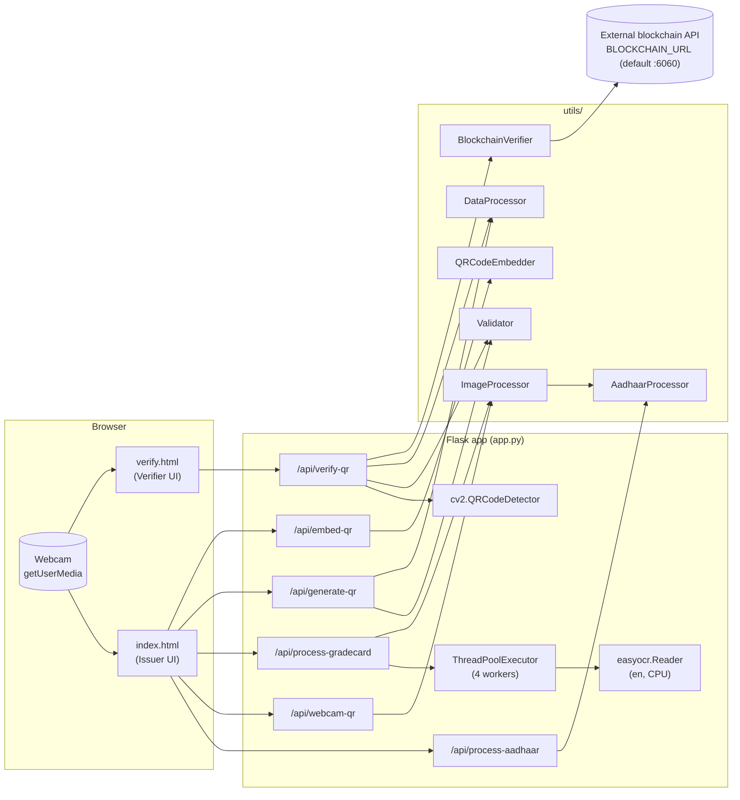
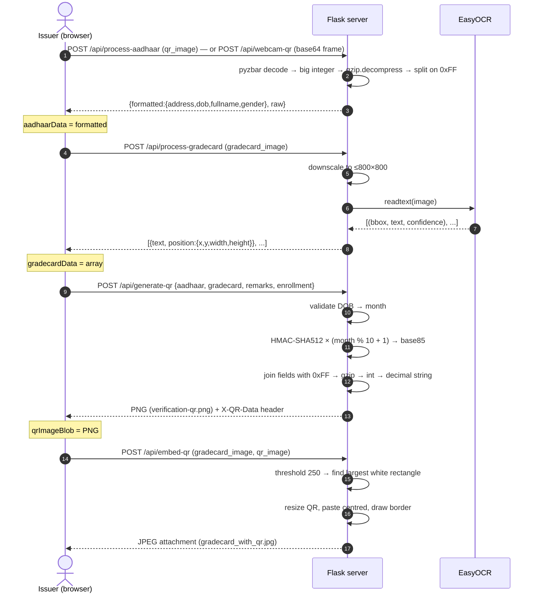
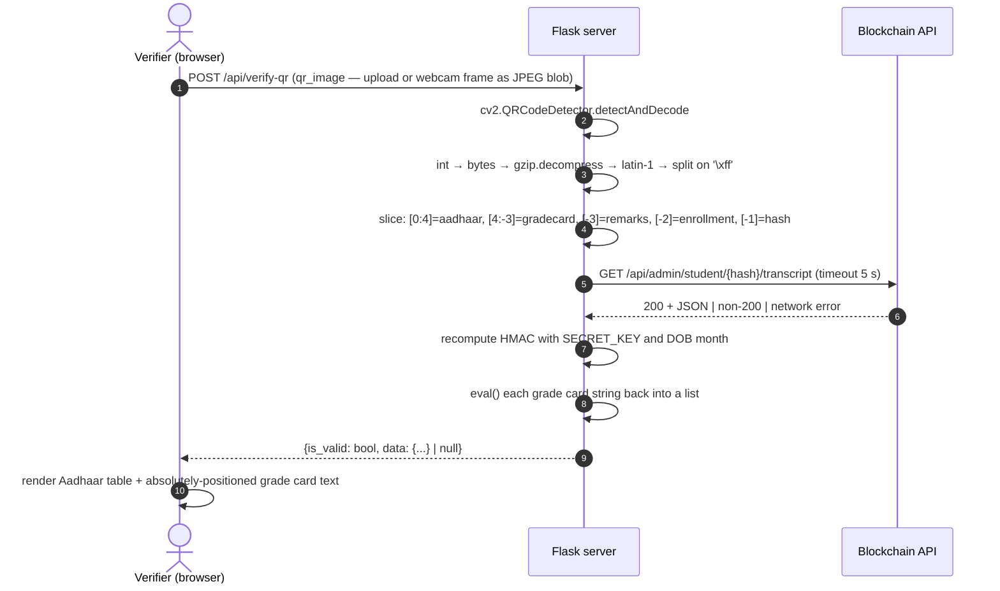

# Document Validation System — Complete Technical Documentation

> **Repository:** [github.com/prtm-bg/DocumentValidationSystem](https://github.com/prtm-bg/DocumentValidationSystem)
> **License:** MIT (© 2025 "Document Validation System")
> **Primary language:** Python 3.9 (Flask) with vanilla HTML/CSS/JavaScript frontend
> **Documentation generated:** 2026-10-16, from commit `9e75026` (branch `main`)

---

## Table of Contents

1. [Introduction](#1-introduction)
2. [Repository at a Glance](#2-repository-at-a-glance)
3. [Directory Structure & File Inventory](#3-directory-structure--file-inventory)
4. [System Architecture](#4-system-architecture)
5. [End-to-End Workflows](#5-end-to-end-workflows)
6. [Backend Reference — `app.py`](#6-backend-reference--apppy)
7. [Utility Package Reference — `utils/`](#7-utility-package-reference--utils)
8. [Data Formats & Cryptography](#8-data-formats--cryptography)
9. [Blockchain Integration](#9-blockchain-integration)
10. [Frontend Reference](#10-frontend-reference)
11. [Configuration Reference — `config.py`](#11-configuration-reference--configpy)
12. [Installation & Local Development](#12-installation--local-development)
13. [Deployment](#13-deployment)
14. [Dependencies](#14-dependencies)
15. [Error Handling & HTTP Status Matrix](#15-error-handling--http-status-matrix)
16. [Security Analysis](#16-security-analysis)
17. [Known Bugs & Limitations](#17-known-bugs--limitations)
18. [Performance Characteristics](#18-performance-characteristics)
19. [Testing](#19-testing)
20. [Recommended Improvements Roadmap](#20-recommended-improvements-roadmap)
21. [Glossary](#21-glossary)
22. [FAQ](#22-faq)

---

## 1. Introduction

### 1.1 What the project does

The **Document Validation System** is a Flask web application that binds an Indian **Aadhaar** identity card to an academic **grade card** (mark sheet / transcript) by producing a single tamper-evident **verification QR code**.

The core idea:

1. Read the identity data from an Aadhaar card's **Secure QR code** (name, date of birth, gender, address).
2. Read the text on a grade card image with **OCR** (EasyOCR), keeping each text fragment's position on the page.
3. Concatenate both data sets (plus optional remarks and an enrollment number), compute a keyed **HMAC-SHA512** signature over them, compress everything with **gzip**, and encode the result as a **numeric QR code** — the same encoding style UIDAI uses for Aadhaar Secure QR.
4. Optionally **stamp the QR onto the grade card image** in the largest blank (white) area.
5. Anyone can later **scan the QR on the `/verify` page**. The server decompresses the payload, recomputes the HMAC, and, if it matches, shows the identity data and redraws the grade card's text layout. As an extra step it asks an external **blockchain service** whether the hash is on record.

### 1.2 Who it is for

- **Issuers** (universities, colleges, exam boards) who want to issue grade cards whose contents can be checked offline from a QR code.
- **Verifiers** (employers, admissions offices) who want to confirm that a grade card has not been altered and that it belongs to the stated person.

### 1.3 Feature list

| Feature | Where it is implemented | Notes |
|---|---|---|
| Aadhaar Secure QR decoding from uploaded image | `POST /api/process-aadhaar` → `AadhaarProcessor.process_qr_data` | Uses `pyzbar` (ZBar) |
| Aadhaar QR scanning from webcam | `POST /api/webcam-qr` | Tries 3 image variants × up to 3 scales |
| Grade card OCR with bounding boxes | `POST /api/process-gradecard` → `perform_ocr` | EasyOCR, English only, CPU |
| Verification QR generation | `POST /api/generate-qr` | HMAC-SHA512 (iterated), gzip, numeric QR |
| QR embedding into the grade card | `POST /api/embed-qr` → `QRCodeEmbedder` | Finds the largest white rectangle |
| Verification of a QR | `POST /api/verify-qr` | OpenCV `QRCodeDetector`, HMAC recomputation |
| Blockchain lookup of the hash | `BlockchainVerifier.verify_hash` | External service, read-only, informational |
| Web UI for issuing | `templates/index.html` (`/`) | Vanilla JS |
| Web UI for verifying | `templates/verify.html` (`/verify`) | Vanilla JS, reconstructs layout |
| Containerisation | `Dockerfile`, `docker-compose.yml` | See [§13](#13-deployment) for issues |
| PaaS deployment | `Procfile`, `runtime.txt` | Heroku-style |

---

## 2. Repository at a Glance

### 2.1 Statistics

| Metric | Value |
|---|---|
| Tracked files | 18 |
| Total lines | ~2,212 |
| Python source lines | 766 (`app.py` 458, `utils/processors.py` 189, `config.py` 59, `utils/blockchain.py` 41, `utils/__init__.py` 19) |
| HTML (with inline CSS/JS) | 794 (`index.html` 482, `verify.html` 312) |
| CSS | 241 (`static/styles.css`) |
| Tests | none |
| CI configuration | none |

### 2.2 Commit history

| Commit | Author | Date (IST) | Message |
|---|---|---|---|
| `ec9b3b3` | prtm-bg | 2025-07-10 15:55:05 | Initial commit |
| `d1a1d52` | prtm-bg | 2025-07-10 15:56:44 | init |
| `9e75026` | prtm-bg | 2025-07-10 16:16:08 | init |

The whole codebase landed in three commits within about 20 minutes. There is no development history to mine, so this document is based entirely on the source code.

---

## 3. Directory Structure & File Inventory

```
DocumentValidationSystem/
├── app.py                  # Flask app: startup, globals, 7 routes, 2 error handlers
├── config.py               # Config classes (Development / Production / Testing)
├── requirements.txt        # 9 pinned Python dependencies
├── runtime.txt             # "python-3.9.*" (PaaS runtime hint)
├── Procfile                # "web: gunicorn app:app --bind 0.0.0.0:$PORT --workers 3"
├── Dockerfile              # python:3.9-slim image + system libs + gunicorn
├── docker-compose.yml      # "web" service + an unused "redis" service
├── LICENSE                 # MIT
├── README.md               # Short project readme
├── STRUCTURE.md            # Short project-structure note
├── .gitignore              # Standard Python ignore list + uploads/, logs/, config_local.py
├── .gitattributes          # "* text=auto" (LF normalisation)
├── static/
│   └── styles.css          # Modern stylesheet — NOT linked by any template
├── templates/
│   ├── index.html          # Issuance UI (Steps 1–3) with inline CSS + JS
│   └── verify.html         # Verification UI with inline CSS + JS
└── utils/
    ├── __init__.py         # Re-exports the 6 helper classes
    ├── processors.py       # ImageProcessor, DataProcessor, AadhaarProcessor, Validator, QRCodeEmbedder
    └── blockchain.py       # BlockchainVerifier (HTTP client)
```

### 3.1 File-by-file summary

| File | Role | Key contents |
|---|---|---|
| `app.py` | Application entry point and the whole HTTP API | `create_app`, `configure_logging`, module-level singletons (`executor`, `reader`, `blockchain_verifier`, processors), `get_qr_detector`, `perform_ocr`, routes `/`, `/verify`, `/api/webcam-qr`, `/api/process-aadhaar`, `/api/process-gradecard`, `/api/generate-qr`, `/api/verify-qr`, `/api/embed-qr`, 404/500 handlers, `__main__` runner |
| `config.py` | Settings | `Config` base class, `DevelopmentConfig`, `ProductionConfig`, `TestingConfig`, `config` lookup dict |
| `utils/__init__.py` | Package facade | Imports and lists the six public classes in `__all__` |
| `utils/processors.py` | Image and data logic | Image downscaling, QR pre-processing, hashing, Aadhaar QR parsing, DOB validation, white-space search for embedding |
| `utils/blockchain.py` | External integration | `BlockchainVerifier.verify_hash()` — `GET {BLOCKCHAIN_URL}/api/admin/student/{hash}/transcript` |
| `templates/index.html` | Issuer UI | Aadhaar upload/webcam, grade card upload, remarks/enrollment, generate QR, embed QR |
| `templates/verify.html` | Verifier UI | Upload/webcam QR, show results, absolutely positioned grade card reconstruction |
| `static/styles.css` | Unused stylesheet | Gradient background, card layout, responsive rules — never referenced |
| `Dockerfile` | Container build | Debian slim + OpenCV runtime libs + gunicorn (3 workers) |
| `docker-compose.yml` | Local orchestration | `web` on :5000 with `./uploads` volume; `redis:alpine` on :6379 (unused) |
| `Procfile` | Heroku-style process | gunicorn on `$PORT`, 3 workers |
| `runtime.txt` | Python version hint | `python-3.9.*` |
| `requirements.txt` | Python deps | Flask, OpenCV, NumPy, Pillow, qrcode, EasyOCR, pyzbar, requests, gunicorn |
| `README.md` | Overview | Features, install steps, API list, security claims |
| `STRUCTURE.md` | Overview | Tree + file descriptions |
| `LICENSE` | Legal | MIT |

---

## 4. System Architecture

### 4.1 Component diagram



### 4.2 Architectural style

- **Single-process monolith.** All routes live in `app.py`. There is no blueprint, service layer, or database.
- **Stateless server.** Nothing is persisted on the server. All state (Aadhaar data, OCR results, generated QR blob) lives in browser JavaScript variables between calls. The `uploads/` directory is created and mounted but never written to.
- **Module-level singletons.** The OCR model, thread pool, blockchain client and processor objects are created when `app.py` is imported. Each gunicorn worker process gets its own copy.
- **"Application factory" in name only.** `create_app()` exists, but `app = create_app()` runs at import time and the routes are bound to that global instance with `@app.route`, so the factory cannot produce independent apps (for example, for tests).

### 4.3 Request lifecycle (typical API call)

1. The browser sends `multipart/form-data` (file uploads) or `application/json`.
2. Flask enforces `MAX_CONTENT_LENGTH` (16 MB). Larger requests get a `413` response.
3. The route decodes the image bytes with `np.frombuffer` + `cv2.imdecode`.
4. The route calls helpers from `utils/`.
5. The response is JSON (`jsonify`) or a binary image (`send_file`).
6. Any exception is caught by the route's own `try/except`, logged, and returned as `{"error": "<message>"}` with status 500 (or 400 in `/api/verify-qr`).

---

## 5. End-to-End Workflows

### 5.1 Issuance workflow (index page `/`)



**UI gating rules** (`index.html`):

- **Generate Verification QR** is enabled only when both `aadhaarData` and `gradecardData` are set (`updateGenerateButtonState`).
- **Embed QR in Grade Card** is enabled only when `#qrResult` contains an `` and a grade card file is still selected (`updateEmbedButtonState`). A `MutationObserver` on `#qrResult` re-runs this check whenever the QR area changes.

### 5.2 Verification workflow (`/verify`)



**What "valid" means:** `is_valid` is `true` only when the recomputed HMAC equals the hash stored in the QR. The blockchain result is attached (`blockchain_verified`, `blockchain_details` / `blockchain_error`) but **does not affect** `is_valid`. Because `data` is set to `null` when the HMAC check fails, the blockchain fields only reach the client for valid QRs, and the bundled UI never shows them.

---

## 6. Backend Reference — `app.py`

### 6.1 Imports (lines 7–28)

Standard library: `os`, `json`, `logging`, `base64`, `gzip`, `io.BytesIO`, `concurrent.futures.ThreadPoolExecutor`, `functools.lru_cache`.
Third-party: `cv2`, `numpy`, `qrcode`, `easyocr`, `requests` (**imported but unused**), Flask's `Flask, render_template, request, jsonify, send_file`, `pyzbar.pyzbar.decode`.
Local: `config.config`; `utils.{ImageProcessor, DataProcessor, AadhaarProcessor, Validator, QRCodeEmbedder, BlockchainVerifier}`.

### 6.2 Application bootstrap (lines 30–68)

```python
def create_app(config_name=None):
    app = Flask(__name__)
    config_name = config_name or os.environ.get('FLASK_ENV', 'development')
    app.config.from_object(config[config_name])
    configure_logging(app)
    return app
```

- The config class comes from the `FLASK_ENV` environment variable (`development` / `production` / `testing`), defaulting to `development`. An unrecognised value raises `KeyError` at import time. Note: Flask itself stopped using `FLASK_ENV` in 2.3; here it is read only by this app's own code.
- `configure_logging` calls `logging.basicConfig(level=INFO, ...)` **only when not in debug or testing mode**. In the default development mode (`DEBUG=True`), nothing configures the root logger, so the many `logger.info(...)` calls produce no output.

Module-level singletons created at import:

| Name | Value | Notes |
|---|---|---|
| `app` | `create_app()` | Global Flask instance |
| `logger` | `logging.getLogger('app')` | |
| `executor` | `ThreadPoolExecutor(max_workers=MAX_WORKERS)` (4) | Used only by `/api/process-gradecard` |
| `reader` | `easyocr.Reader(['en'], gpu=False)` | Loads PyTorch detection and recognition models. **Downloads them on first run** (into `~/.EasyOCR/`) if missing. Slow and memory-heavy. |
| `blockchain_verifier` | `BlockchainVerifier(BLOCKCHAIN_URL, BLOCKCHAIN_TIMEOUT)` | |
| `image_processor`, `data_processor`, `aadhaar_processor`, `validator`, `qr_embedder` | Instances of the utils classes | All their methods are `@staticmethod`, so the instances only serve as namespaces |

### 6.3 Helpers

#### `get_qr_detector()` (lines 70–73)
Returns a `cv2.QRCodeDetector()` behind `@lru_cache(maxsize=100)`. Because the function takes no arguments, the cache only ever holds one entry, so this is effectively a lazily created singleton.

#### `perform_ocr(image)` (lines 75–93)
1. `image_processor.optimize_image(image)` downscales to fit within 800×800 (raises `ValueError("Invalid image data")` if `image is None`).
2. `reader.readtext(image)` returns `[(bbox, text, confidence), ...]`, where `bbox` holds the four corner points `[[x0,y0],[x1,y1],[x2,y2],[x3,y3]]` (top-left, top-right, bottom-right, bottom-left).
3. Converts each result to:
   ```json
   {"text": "...", "position": {"x": x0, "y": y0, "width": x2-x0, "height": y2-y0}, "confidence": 0.97}
   ```
   It drops entries whose text is blank after `strip()`.
4. **Coordinates are in the downscaled image's pixel space**, not the original upload's.

### 6.4 Routes

#### 6.4.1 `GET /` → `index()`
Renders `templates/index.html` (the issuer UI).

#### 6.4.2 `GET /verify` → `verify()`
Renders `templates/verify.html` (the verifier UI). No page links to it; users must type the URL.

---

#### 6.4.3 `POST /api/webcam-qr` → `webcam_qr()` (lines 105–172)

Decodes a QR from a single webcam frame and tries to parse it as an Aadhaar Secure QR.

**Request** — `application/json`
```json
{ "image": "data:image/jpeg;base64,/9j/4AAQ..." }
```
The `data:` prefix is optional. Everything after the first comma is base64-decoded.

**Processing**
1. Base64 → bytes → `cv2.imdecode(..., IMREAD_COLOR)`.
2. `ImageProcessor.optimize_for_qr_scanning()` returns grayscale (`original`), adaptive-threshold (`binary`), sharpened-binary (`sharpened`) images and a list of `sizes`: native, 1.5× (only if a side is < 1000 px), and 2×.
3. It tries each variant in order `original → binary → sharpened`, and each size within a variant, resizing when needed, and runs `pyzbar.decode` until something decodes. That is at most 9 attempts.
4. It tries `aadhaar_processor.process_qr_data(qr_data)`. If parsing fails, the QR is reported as generic.

**Responses**

| Case | Status | Body |
|---|---|---|
| Aadhaar QR parsed | 200 | `{"type":"aadhaar","formatted":{...},"raw":"..."}` |
| QR found, not Aadhaar | 200 | `{"type":"generic","data":"<qr text>"}` |
| No QR found | **200** | `{"message":"No QR code found"}` |
| Missing `image` | 400 | `{"error":"No image data provided"}` |
| Undecodable image | 400 | `{"error":"Failed to decode image"}` |
| Any other exception (bad base64, body not JSON, ...) | 500 | `{"error":"<exception text>"}` |

**Example**
```bash
curl -X POST http://localhost:5000/api/webcam-qr \
  -H "Content-Type: application/json" \
  -d "{\"image\": \"$(base64 -w0 aadhaar_qr.jpg)\"}"
```

---

#### 6.4.4 `POST /api/process-aadhaar` → `process_aadhaar()` (lines 173–200)

**Request** — `multipart/form-data` with the file field `qr_image`.

**Processing:** decode the image → convert to grayscale → `pyzbar.decode` → take the first QR's data → `AadhaarProcessor.process_qr_data`. Unlike the webcam route, there is **no multi-variant retry**.

**Responses**

| Case | Status | Body |
|---|---|---|
| Success | 200 | `{"formatted":{"address":"...","dob":"DD-MM-YYYY","fullname":"...","gender":"M"},"raw":"<fields joined by \\xff>"}` |
| No file field | 400 | `{"error":"No QR image provided"}` |
| Image unreadable | 400 | `{"error":"Unable to read image"}` |
| No QR in image | 400 | `{"error":"No QR code detected"}` |
| QR is not a Secure Aadhaar QR | **500** | `{"error":"Invalid Aadhaar QR data: ..."}` |

> **Key ordering note:** Flask 3's JSON provider sorts keys by default (`sort_keys=True`), so `formatted` arrives in the browser as `address, dob, fullname, gender`, even though Python built it as `fullname, dob, gender, address`. The QR generation and verification steps **rely on this alphabetical order** (see [§8.3](#83-verification-qr-payload-format)).

**Example**
```bash
curl -F "qr_image=@aadhaar_qr.png" http://localhost:5000/api/process-aadhaar
```

---

#### 6.4.5 `POST /api/process-gradecard` → `process_gradecard()` (lines 202–225)

**Request** — `multipart/form-data` with the file field `gradecard_image`.

**Processing:** decode the image → `executor.submit(perform_ocr, img)` → **block on `.result()` immediately**, so the thread pool only caps concurrent OCR jobs per process; it adds no parallelism within a request → remove `confidence` from each item.

**Response 200** — JSON array:
```json
[
  {"text": "UNIVERSITY OF EXAMPLE", "position": {"x": 212, "y": 31, "width": 377, "height": 28}},
  {"text": "SGPA", "position": {"x": 540, "y": 610, "width": 44, "height": 18}}
]
```

**Errors:** missing field → 400 `{"error":"No grade card image provided"}`. An unreadable image or OCR failure → 500. An undecodable image surfaces as `"Invalid image data"`.

**Example**
```bash
curl -F "gradecard_image=@gradecard.jpg" http://localhost:5000/api/process-gradecard
```

---

#### 6.4.6 `POST /api/generate-qr` → `generate_qr()` (lines 227–299)

**Request** — `application/json`
```json
{
  "aadhaar":   {"address": "...", "dob": "15-08-2002", "fullname": "...", "gender": "F"},
  "gradecard": [{"text": "...", "position": {"x":0,"y":0,"width":0,"height":0}}, ...],
  "remarks":   "optional free text",
  "enrollment":"optional string"
}
```
`aadhaar` and `gradecard` are required. `aadhaar.dob` must be `DD/MM/YYYY` or `DD-MM-YYYY`.

**Processing (step by step)**

1. `dob_month = validator.validate_dob(aadhaar.dob)` gives an integer 1–12.
2. Build `combined_data`, a **list of strings**:
   - `str(v)` for each value of `aadhaar` **in the order the client sent the keys**
   - for each OCR item: `str([x, y, width, height, text])`, i.e. a Python list repr such as `"[212, 31, 377, 28, 'UNIVERSITY OF EXAMPLE']"`
   - `str(remarks)` (default `''`)
   - `str(enrollment)` (default `''`)
3. `hash_value = DataProcessor.generate_hash(json.dumps(combined_data, sort_keys=True), dob_month, SECRET_KEY)` (see [§8.4](#84-signature-scheme)).
4. `final_data = b'\xff'.join(s.encode('ISO-8859-1') for s in [*combined_data, hash_value])`.
5. `compressed = int.from_bytes(gzip.compress(final_data), 'big')`, so the gzip stream becomes one huge integer.
6. Build the QR: `qrcode.QRCode(version=None, error_correction=ERROR_CORRECT_L, box_size=10, border=4)`, `add_data(compressed)`. The integer's decimal digits are encoded in **numeric mode**, and `make(fit=True)` chooses the smallest QR version that fits.
7. Render a black-on-white PNG into memory.

**Response 200** — `image/png` (inline, `download_name=verification-qr.png`) with headers:

| Header | Value |
|---|---|
| `Cache-Control` | `no-cache, no-store, must-revalidate` |
| `Pragma` | `no-cache` |
| `X-QR-Data` | The full decimal string encoded in the QR. This can run to thousands of characters. |

**Errors:** non-JSON → 400 `"No JSON data received"`. Missing keys → 400 `"Missing required data"`. Everything else → 500. That includes a bad DOB, characters outside Latin-1 in any field (`UnicodeEncodeError`), a payload too large for a version-40 QR (`DataOverflowError`), and a string `SECRET_KEY` (see [§16.2](#162-high-secret_key-type-mismatch-breaks-signing-whenever-it-is-set-via-environment)).

**Example**
```bash
curl -X POST http://localhost:5000/api/generate-qr \
  -H "Content-Type: application/json" \
  -d @payload.json -o verification-qr.png -D headers.txt
```

---

#### 6.4.7 `POST /api/verify-qr` → `verify_qr()` (lines 300–364)

**Request** — `multipart/form-data` with the file field `qr_image`. This can be the bare QR PNG, a photo of it, or the grade card JPEG with the embedded QR.

**Processing**

1. Decode the image and run `cv2.QRCodeDetector().detectAndDecode(img)`. **This route uses OpenCV's detector, not ZBar**, unlike the other two QR routes.
2. `int(data)` → bytes → `gzip.decompress` → `.decode('ISO-8859-1')` → `.split('\xff')`.
3. Slice positionally:
   ```
   aadhaar_data   = parts[:4]     # address, dob, fullname, gender (alphabetical — see note)
   gradecard_data = parts[4:-3]   # list-repr strings
   remarks        = parts[-3]
   enrollment     = parts[-2]
   stored_hash    = parts[-1]
   ```
4. Build `combined_data = {'aadhaar': dict(zip(['address','dob','fullname','gender'], aadhaar_data)), 'gradecard': ..., 'remarks': ..., 'enrollment': ...}`.
5. **Blockchain lookup** `blockchain_verifier.verify_hash(stored_hash)`. It sets `blockchain_verified` plus `blockchain_details` or `blockchain_error`. This runs **before** the HMAC check and can add up to 5 s of latency when the service is unreachable.
6. Recompute the month from the DOB and the HMAC over `json.dumps([*aadhaar_data, *gradecard_data, remarks, enrollment], sort_keys=True)`.
7. `combined_data['gradecard'] = [eval(i) for i in gradecard_data]`. **⚠ Critical security issue — see [§16.1](#161-critical-arbitrary-code-execution-via-eval-in-apiverify-qr).**
8. Return the result.

**Responses**

| Case | Status | Body |
|---|---|---|
| Valid | 200 | `{"is_valid": true, "data": {"aadhaar":{...},"gradecard":[[x,y,w,h,"text"],...],"remarks":"...","enrollment":"...","blockchain_verified":false,"blockchain_error":"..."}}` |
| Signature mismatch | 200 | `{"is_valid": false, "data": null}` |
| No QR found | 400 | `{"error":"No QR code detected"}` |
| Any exception (non-numeric QR, bad gzip, bad DOB, ...) | **400** | `{"error":"<exception text>"}` |

**Example**
```bash
curl -F "qr_image=@gradecard_with_qr.jpg" http://localhost:5000/api/verify-qr
```

---

#### 6.4.8 `POST /api/embed-qr` → `embed_qr()` (lines 366–443)

**Request** — `multipart/form-data` with two files: `gradecard_image` and `qr_image`.

**Processing**

1. Decode both images (colour).
2. Convert the grade card to grayscale and apply `cv2.threshold(gray, 250, 255, THRESH_BINARY)`. Only near-pure-white pixels (> 250) count as free space.
3. `QRCodeEmbedder.find_largest_white_space(binary)` returns the corners `(x1, y1, x2, y2)` of the largest white rectangle the greedy scan finds (see [§7.5](#75-qrcodeembedder)).
4. `qr_size = min(w, h) - 20` (padding). If it is below 100 px, the route rejects the request.
5. `cv2.resize(qr_img, (qr_size, qr_size))` with the default bilinear interpolation.
6. Centre the QR in the rectangle, paint a white rectangle 5 px larger on every side, paste the QR pixels, and draw a 2 px black border.
7. Encode as JPEG at quality 95.

**Response 200** — `image/jpeg` as an attachment named `gradecard_with_qr.jpg`.

**Errors**

| Case | Status | Body |
|---|---|---|
| Either file missing | 400 | `"Both grade card and QR images are required"` |
| No white pixels at all | 400 | `"No suitable white space found"` |
| Largest space < 120 px on its short side | 400 | `"White space too small for QR code"` |
| Unreadable image / other | 500 | exception text |

**Example**
```bash
curl -F "gradecard_image=@gradecard.jpg" -F "qr_image=@verification-qr.png" \
     http://localhost:5000/api/embed-qr -o gradecard_with_qr.jpg
```

---

#### 6.4.9 Error handlers (lines 445–454)

| Handler | Returns |
|---|---|
| `404` | `{"error":"Resource not found"}`, 404 |
| `500` | `{"error":"Internal server error"}`, 500 (and logs it) |

Other framework errors (`405 Method Not Allowed`, `413 Request Entity Too Large`) fall back to Flask's default **HTML** responses, because they have no JSON handlers.

#### 6.4.10 Direct execution (lines 456–459)

```python
if __name__ == '__main__':
    port  = int(os.environ.get('PORT', 5000))
    debug = os.environ.get('FLASK_ENV') == 'development'
    app.run(host='0.0.0.0', port=port, debug=debug)
```

The development server binds to **all interfaces** (`0.0.0.0`). The Werkzeug debugger is enabled only when `FLASK_ENV=development` is set explicitly. When the variable is unset, `DevelopmentConfig` is loaded but the debugger stays off.

---

## 7. Utility Package Reference — `utils/`

`utils/__init__.py` re-exports: `ImageProcessor`, `DataProcessor`, `AadhaarProcessor`, `Validator`, `QRCodeEmbedder`, `BlockchainVerifier`. Every method in `processors.py` is a `@staticmethod`.

### 7.1 `ImageProcessor`

#### `optimize_image(image, max_size=(800, 800)) -> np.ndarray` (`processors.py:21`)
- Raises `ValueError("Invalid image data")` when `image is None`.
- If height > 800 **or** width > 800, scales by `min(800/h, 800/w)` with `INTER_AREA`, which keeps the aspect ratio. Smaller images are returned unchanged and never upscaled.
- Used only by OCR. Downscaling speeds up OCR but can hurt accuracy on small print. A full-page A4 scan at 300 DPI (2480×3508) shrinks to roughly 566×800.

#### `optimize_for_qr_scanning(image) -> dict` (`processors.py:35`)
Returns:

| Key | Content |
|---|---|
| `original` | Grayscale image |
| `binary` | `adaptiveThreshold(gray, 255, ADAPTIVE_THRESH_GAUSSIAN_C, THRESH_BINARY, blockSize=11, C=2)` |
| `sharpened` | `filter2D(binary, -1, [[-1,-1,-1],[-1,9,-1],[-1,-1,-1]])`, a Laplacian-style sharpening kernel |
| `sizes` | `[(w,h)]`, plus `(1.5w,1.5h)` if either side < 1000, plus `(2w,2h)` |

Aadhaar Secure QRs are very dense (often version 25–40), so webcam frames are upscaled to give ZBar more pixels per module.

### 7.2 `DataProcessor`

#### `compress_data(data_dict) -> str` (`processors.py:69`)
Compact JSON → `zlib.compress(level=9)` → base85 text. **Never called anywhere.** The README's "zlib" and "Base85 for data integrity" claims refer to this dead code; the live path uses gzip and a numeric QR.

#### `generate_hash(data_str, dob_month, secret_key) -> str` (`processors.py:77`)
```python
iterations = int(dob_month) % 10 + 1          # month 1→2, 9→10, 10→1, 11→2, 12→3
h = data_str.encode()                          # UTF-8
for _ in range(iterations):
    h = hmac.new(secret_key, h, hashlib.sha512).digest()
return base64.b85encode(h).decode()            # 64 bytes → 80 base85 chars
```
- Decorated with `@lru_cache(maxsize=1000)`, so repeated identical inputs are served from memory. All arguments must be hashable, which they are.
- `secret_key` **must be `bytes`**. `hmac.new` raises `TypeError` for `str`.
- The DOB-dependent iteration count adds no real security: the month is stored in plain text in the same QR, and 1–10 HMAC rounds cost almost nothing to compute. Security rests entirely on the secrecy of `SECRET_KEY`.

### 7.3 `AadhaarProcessor`

#### `process_qr_data(qr_data) -> (formatted: dict, raw: str)` (`processors.py:91`)

Parses a **UIDAI Secure QR** (the format printed on Aadhaar cards and e-Aadhaar PDFs since 2019):

1. The QR text is a large decimal integer. Convert it to big-endian bytes and `gzip.decompress` them.
2. Split on byte `0xFF`, **discard empty fields**, and decode each as ISO-8859-1.
3. Map positional fields:

| Index used | Field (per UIDAI Secure QR v2 layout) | Output |
|---|---|---|
| 3 | Name | `fullname` |
| 4 | Date of birth (`DD-MM-YYYY`) | `dob` |
| 5 | Gender (`M`/`F`/`T`) | `gender` |
| 8, 9, 13, 7, 15, 14, 6, 12, 10 | Landmark, House, State, District, Sub-district, Street, Care-of, Post office, Location | Joined with `" , "` into `address` |

(Index 0 is the version marker such as `V2`, 1 the email/mobile-hash indicator, 2 the reference ID, 11 the PIN code and 16 the village/town/city. The PIN code and VTC are **not** included in the address. The photo and the 256-byte RSA signature follow the text fields and are ignored.)

4. `raw` = name, dob, gender, then the nine address parts, joined with `'\xff'`. It is returned to the client but never used.
5. Any exception is re-raised as `ValueError("Invalid Aadhaar QR data: ...")`.

> ⚠ **Index-shift risk:** dropping empty fields (`if f`) shifts every later index whenever an optional field (often *Landmark* or *Care-of*) is blank on a given card, so address parts and even name/DOB/gender can be mis-assigned. The code also does **not** verify UIDAI's digital signature, so a forged Aadhaar QR is accepted.
> Older XML-based Aadhaar QR codes (pre-2018) are not supported.

### 7.4 `Validator`

#### `validate_dob(dob) -> int` (`processors.py:118`)
- `dob` must be a `str` containing `/` or `-` and split into exactly 3 parts. The middle part, parsed as an integer, must be 1–12.
- Returns the month. It checks neither the day nor the year, and it assumes the order `DD?MM?YYYY` (`YYYY-MM-DD` would also pass, since the middle part is still the month).

#### `is_allowed_file(filename, allowed_extensions) -> bool` (`processors.py:140`)
Extension whitelist check. **Never called**; uploads are not filtered by extension.

### 7.5 `QRCodeEmbedder`

#### `find_white_rectangle(binary_img, start_y, start_x)` (`processors.py:149`)
From a seed pixel:
1. Extend **down** while column `start_x` stays white → `end_y`.
2. Extend **right** while every pixel in rows `start_y..end_y-1` of the next column is white → `end_x`.
3. Return `(start_x, start_y, end_x-1, end_y-1)`.

#### `find_largest_white_space(binary_img)` (`processors.py:172`)
- Scans every pixel in row-major order with **pure-Python nested loops**. For each white pixel that no earlier rectangle has covered, it grows a rectangle as above, keeps the one with the largest area, and marks its pixels as processed.
- This greedy heuristic is **not** a true maximal-rectangle algorithm. It is biased toward tall rectangles anchored at their top-left corner.
- It is **very slow** on real scans, potentially minutes per image at full resolution. See [§18](#18-performance-characteristics).
- Returns `None` when there are no white pixels.

---

## 8. Data Formats & Cryptography

### 8.1 Aadhaar Secure QR (input)

```
QR text:  "4831948…(thousands of decimal digits)…"
            │ int(...) → big-endian bytes
            ▼
gzip stream ── decompress ──► V2 ⟨FF⟩ ind ⟨FF⟩ refid ⟨FF⟩ name ⟨FF⟩ dob ⟨FF⟩ gender ⟨FF⟩ careof ⟨FF⟩ district ⟨FF⟩ … ⟨FF⟩ vtc ⟨FF⟩ [photo JPEG2000][signature 256 B]
```

### 8.2 Grade card item string

Each OCR result is serialised as a Python list literal:

```
"[x, y, width, height, 'text']"
```
For example, `"[540, 610, 44, 18, 'SGPA']"`. Python's `repr` escapes quotes inside `text`.

### 8.3 Verification QR payload format

**Logical layout before compression** (fields separated by byte `0xFF`, each encoded ISO-8859-1):

| # | Field | Example |
|---|---|---|
| 1 | Aadhaar value #1 | `"Flat 2 , Near Park , Karnataka , …"` (address) |
| 2 | Aadhaar value #2 | `"15-08-2002"` (dob) |
| 3 | Aadhaar value #3 | `"Jane Doe"` (fullname) |
| 4 | Aadhaar value #4 | `"F"` (gender) |
| 5 … N | Grade card items | `"[212, 31, 377, 28, 'UNIVERSITY OF EXAMPLE']"` |
| N+1 | Remarks | `"Provisional"` |
| N+2 | Enrollment | `"EN2021001"` |
| N+3 | Signature | 80-char base85 string |

**Encoding pipeline:** `bytes → gzip.compress → int.from_bytes(big) → decimal string → QR numeric mode, EC level L`.

Notes:
- **Aadhaar field order is implicit.** Generation writes the values in whatever order the client's JSON object holds them. Verification assumes `address, dob, fullname, gender`. This works only because Flask's `jsonify` sorts keys alphabetically when `/api/process-aadhaar` responds and the browser keeps that order. A third-party client that sends `{"fullname":..., "dob":..., ...}` produces a QR that verifies (the hash covers the same ordered list) but **displays fields under the wrong labels**. In that example the address is shown as the name, and the gender as the address. If the value in the second position is not a valid DOB, `validate_dob(combined_data['aadhaar']['dob'])` raises and verification fails with 400.
- **Exactly four Aadhaar values are assumed** (`[:4]`). Any extra key shifts every later field.
- **Delimiter collisions:** a `'ÿ'` (U+00FF) character in any field splits it into two.
- **Characters outside Latin-1** (Devanagari, `₹`, curly quotes, many OCR artefacts) raise `UnicodeEncodeError` during generation.
- **Non-deterministic bytes:** the gzip header stores a timestamp, so generating twice with identical data gives different QR images. The signature is the same both times.
- **Capacity:** a version-40-L QR holds at most 7,089 numeric digits ≈ 2,950 bytes of gzip output. Grade cards with many OCR fragments can overflow this and make generation fail.
- **Privacy:** the payload is compressed, **not encrypted**. Anyone who scans the QR can run the same three decoding steps and read the name, DOB, gender and full address.

### 8.4 Signature scheme

```
message    = json.dumps([aadhaar…, gradecard_item_strings…, remarks, enrollment], sort_keys=True)  # a JSON array of strings
rounds     = (dob_month % 10) + 1
h0         = message.encode('utf-8')
h(i+1)     = HMAC-SHA512(SECRET_KEY, h(i))
signature  = base85(h(rounds))        # 80 ASCII chars
```

- `sort_keys=True` has no effect, because the top-level object is a list.
- Verification recomputes the signature with the same procedure and compares with `==`. That is not a constant-time comparison (`hmac.compare_digest` would be), but over HTTP the timing side-channel is minor.
- Only parties that hold `SECRET_KEY` can mint valid QRs, and only the same server, or one sharing the key, can verify them. It is a **symmetric** scheme, so verifiers cannot check offline without the key.

---

## 9. Blockchain Integration

`utils/blockchain.py` → `BlockchainVerifier`

| Aspect | Behaviour |
|---|---|
| Constructor | `BlockchainVerifier(base_url, timeout=5)`. Strips the trailing `/` from the URL. |
| Call | `GET {base_url}/api/admin/student/{hash_value}/transcript` |
| Success | HTTP 200 → `{'verified': True, 'details': json['details'], 'data': json}` |
| Non-200 | `{'verified': False, 'error': 'HTTP <code>'}` |
| Network failure / timeout | `{'verified': False, 'error': '<exception>'}` |
| Configuration | `BLOCKCHAIN_URL` (env, default `http://localhost:6060`), `BLOCKCHAIN_TIMEOUT` = 5 s |

**Important facts**

- The blockchain service is **external and not included** in this repository. Nothing in this codebase **writes** hashes to it; issuance never contacts it. Some other system must register hashes there.
- The result is **informational only** and never changes `is_valid`.
- The hash is placed in the URL path **without URL-encoding**. Python's base85 alphabet includes `? # % & ; < > { } | ^ \``, so most hashes produce malformed paths: everything after `?` becomes a query string, and everything after `#` is dropped. Use `urllib.parse.quote(hash_value, safe='')` or switch to hex.
- The path `/api/admin/...` suggests an admin endpoint, yet the call sends **no authentication**.
- If an exception other than `requests.RequestException` occurs, such as invalid JSON in a 200 response, it propagates and turns the whole verification into a 400 error.

---

## 10. Frontend Reference

Both pages are self-contained. All CSS sits in a `<style>` block and all JavaScript in a `<script>` block, with no external libraries or build step. **`static/styles.css` is not linked from either page.**

### 10.1 `templates/index.html` — Issuer UI

**Layout**

| Section | Elements (ids) |
|---|---|
| Step 1: Scan Aadhaar QR | `#qrImageInput` (file), `#processAadhaarButton`, `#startCameraButton`, `#stopCameraButton`, `#videoContainer` → `#webcamVideo`, `#captureButton`, `#aadhaarStatus` |
| Step 2: Upload Grade Card | `#gradecardImageInput`, `#processGradecardButton`, `#gradecardStatus` |
| Additional Information | `#remarks` (textarea), `#enrollment` (text) |
| Generate | `#generateQRButton`, `#qrResult` |
| Step 3: Embed | `#embedQRButton`, `#embedResult` |

**Client state (global `let`s)**

| Variable | Set by | Used by |
|---|---|---|
| `aadhaarData` | Aadhaar upload or webcam success | Generate |
| `gradecardData` | Grade card OCR success | Generate |
| `videoStream` | Start Camera | Capture / Stop |
| `generatedQRData` | Generate (request body) | Embed (presence check only) |
| `qrImageBlob` | Generate success (PNG blob) | Embed (sent as `qr_image`) |

**Event handlers**

| Control | Action |
|---|---|
| Process Aadhaar QR | `FormData{qr_image}` → `/api/process-aadhaar`. On success shows the name and DOB. On a non-2xx response it shows `Server returned <status>`, discarding the server's error text. |
| Start Camera | `getUserMedia({video:{facingMode:'environment'}})`, preferring the rear camera on phones |
| Capture QR Code | Draws the frame to a canvas → `toDataURL('image/jpeg')` → JSON to `/api/webcam-qr` |
| Stop Camera | Stops all tracks and hides the video |
| Process Grade Card | `FormData{gradecard_image}` → `/api/process-gradecard`. Shows the number of text elements found. |
| Generate Verification QR | JSON → `/api/generate-qr`. Shows the PNG and a download link. |
| Embed QR in Grade Card | `FormData{gradecard_image, qr_image}` → `/api/embed-qr`. Shows the result and a download link. |

**UX caveats**
- Status messages are built with `innerHTML` and template literals that include server data (Aadhaar name, error text). See XSS in [§16.4](#164-medium-stored-xss-on-the-verification-page).
- Changing the selected grade card file after OCR does not reset `gradecardData`, so the QR and the embedded image can come from different files.
- The download anchors use class `button`, which the inline CSS defines.
- Camera access requires a **secure context** (HTTPS or `localhost`). On plain-HTTP LAN addresses the camera buttons fail.

### 10.2 `templates/verify.html` — Verifier UI

**Layout:** `#qrImageInput`, `#verifyQrButton`, camera controls (same ids as on the index page), `#scanStatus`, `#verificationResult`.

**Flow:** both upload and webcam capture end in `verifyQR(formData)`. A webcam frame is turned into a `Blob` by `fetch(dataURL)` and posted as `qr_image=webcam-capture.jpg` to `/api/verify-qr`. **It does not use `/api/webcam-qr`.**

**Rendering (`displayVerificationData`)**
- **Aadhaar Information** table: Name, DOB, Gender, Address.
- **Grade Card Elements**: a fixed 600 px-tall `.document-view` container (`overflow: hidden`). Each `[x, y, w, h, text]` becomes an absolutely positioned `<div class="document-element">` at those pixel coordinates. The coordinates come from the ≤800 px OCR image, so the layout roughly fits. Content below y = 600 is clipped, and on narrow screens content beyond the container width is clipped too.
- **Remarks** and **Enrollment Number**, when present.
- `blockchain_verified` / `blockchain_details` are **not displayed**.

### 10.3 `static/styles.css` (unused)

A more polished design system that is never applied: purple gradient background (`#667eea → #764ba2`), white `.container` card, blue gradient buttons with hover lift, green `.active` state, `.success`/`.error` alert boxes with coloured left borders, `.button-link`, `.camera-container`, `.video-container`, and a `@media (max-width: 768px)` block with full-width buttons. To use it, add the following to each template's `<head>` (and wrap the body content in `<div class="container">`):

```html
<link rel="stylesheet" href="{{ url_for('static', filename='styles.css') }}">
```

---

## 11. Configuration Reference — `config.py`

### 11.1 Selection

`FLASK_ENV` → `config[...]`:

| `FLASK_ENV` | Class | DEBUG | TESTING |
|---|---|---|---|
| *(unset)* / `development` / `default` | `DevelopmentConfig` | True | False |
| `production` | `ProductionConfig` | False | False |
| `testing` | `TestingConfig` | True | True |

### 11.2 Keys

| Key | Default | Used? | Purpose / notes |
|---|---|---|---|
| `SECRET_KEY` | `env SECRET_KEY` **or** `b'supersecretkey'` | ✅ HMAC key | Must be **bytes** for `hmac.new`. In `ProductionConfig` it is `os.environ.get('SECRET_KEY')`, which is a `str` or `None`, and **either breaks signing**. See §16.2. |
| `MAX_CONTENT_LENGTH` | 16 MiB | ✅ by Flask | Larger uploads get an HTML 413 response |
| `UPLOAD_FOLDER` | `'uploads'` | ❌ | Never written to |
| `ALLOWED_EXTENSIONS` | png, jpg, jpeg, gif, bmp, tiff | ❌ | `Validator.is_allowed_file` exists but is never called |
| `OCR_LANGUAGES` | `['en']` | ✅ | EasyOCR language list (e.g. add `'hi'` for Hindi; that also requires removing the Latin-1 restriction) |
| `OCR_GPU` | `False` | ✅ | Set `True` for a CUDA-enabled PyTorch |
| `QR_ERROR_CORRECTION` | `'L'` | ✅ | `L` / `M` / `Q` / `H`. Higher levels reduce capacity. |
| `QR_BOX_SIZE` | 10 | ✅ | Pixels per QR module |
| `QR_BORDER` | 4 | ✅ | Quiet-zone width in modules |
| `MAX_WORKERS` | 4 | ✅ | OCR thread pool size |
| `CACHE_SIZE` | 1000 | ❌ | The `lru_cache` size is hard-coded instead |
| `BLOCKCHAIN_URL` | env or `http://localhost:6060` | ✅ | |
| `BLOCKCHAIN_TIMEOUT` | 5 | ✅ | Seconds |
| `SESSION_COOKIE_SECURE/HTTPONLY/SAMESITE`, `PERMANENT_SESSION_LIFETIME` | Production only | ❌ in practice | The app never uses `session` |
| `WTF_CSRF_ENABLED` | Testing only | ❌ | Flask-WTF is not installed |

### 11.3 Environment variables

| Variable | Read by | Effect |
|---|---|---|
| `FLASK_ENV` | `create_app`, `__main__` | Config class, and the debugger when run directly |
| `SECRET_KEY` | `config.py` | HMAC key. **Must be bytes; see §16.2.** |
| `BLOCKCHAIN_URL` | `config.py` | Blockchain endpoint base URL |
| `PORT` | `__main__`, `Procfile` | Listening port |

---

## 12. Installation & Local Development

### 12.1 Prerequisites

- **Python 3.9** (pinned versions such as `numpy==1.24.3` do not ship wheels for Python ≥ 3.12). Python 3.9 reached end-of-life in October 2025; see the roadmap.
- **ZBar shared library**, needed by `pyzbar`:
  - Windows: bundled inside the `pyzbar` wheel. You may also need the *Visual C++ 2013 Redistributable*.
  - macOS: `brew install zbar`
  - Debian/Ubuntu: `sudo apt-get install libzbar0`
- About **2–3 GB of disk** for PyTorch, which EasyOCR pulls in, plus the EasyOCR model files (~100 MB, downloaded on first start).
- Internet access on first start, for the model download.

### 12.2 Steps

```bash
git clone https://github.com/prtm-bg/DocumentValidationSystem.git
cd DocumentValidationSystem

python -m venv venv
# Windows: venv\Scripts\activate      macOS/Linux: source venv/bin/activate

pip install -r requirements.txt

# Optional (POSIX shells)
export FLASK_ENV=development
# (Do NOT set SECRET_KEY as a plain env var yet; see §16.2.)

python app.py
# → http://localhost:5000        (issuer UI)
# → http://localhost:5000/verify (verifier UI)
```

The first start can take a minute or more while EasyOCR downloads and loads its models.

### 12.3 Using the app

1. On `/`, upload a photo or screenshot of an Aadhaar **Secure QR** (or use the camera) → **Process Aadhaar QR**.
2. Upload the grade card image → **Process Grade Card**.
3. Optionally fill in Remarks and Enrollment Number.
4. Click **Generate Verification QR**, then download it if needed.
5. Click **Embed QR in Grade Card**, then download `gradecard_with_qr.jpg`.
6. On `/verify`, upload the QR or the stamped grade card (or scan it) → **Verify QR Code**.

### 12.4 Troubleshooting

| Symptom | Cause / fix |
|---|---|
| `ImportError: Unable to find zbar shared library` | Install ZBar (see §12.1) |
| Very slow first start | EasyOCR model download/load. Normal on first run. |
| `Invalid Aadhaar QR data: ...` | The QR is not an Aadhaar Secure QR, or optional fields are empty and shift the indices |
| `key: expected bytes or bytearray, but got 'str'` on generate | `SECRET_KEY` set via environment. See §16.2. |
| `'latin-1' codec can't encode character ...` | A non-Latin-1 character in OCR text, remarks or enrollment |
| `Data too large` / overflow on generate | Too many OCR fragments for one QR |
| `No QR code detected` on verify | OpenCV failed on a dense or blurry QR. Try a sharper or larger image, or the bare PNG. |
| Embed takes minutes | Pure-Python white-space search. Downscale the grade card first. |
| Camera button errors on a LAN IP | `getUserMedia` needs HTTPS or localhost |

---

## 13. Deployment

### 13.1 Docker

`Dockerfile` summary: `python:3.9-slim` → `apt-get install` OpenCV/GTK runtime libraries → `pip install -r requirements.txt` → copy the source → `mkdir uploads` → `EXPOSE 5000` → `HEALTHCHECK curl` → `gunicorn --bind 0.0.0.0:5000 --workers 3 app:app`.

```bash
docker build -t docvalidation .
docker run -p 5000:5000 -e FLASK_ENV=production docvalidation
```

**Known issues with the Dockerfile as written**

| Line | Problem | Fix |
|---|---|---|
| 15 | `libgl1-mesa-glx` no longer exists in Debian 12 (bookworm), the base of current `python:3.9-slim` images, so `apt-get` fails and the **build breaks** | Use `libgl1` (or switch to `opencv-python-headless`) |
| 17 | Installs `libqrencode4`, which nothing uses, but **not `libzbar0`**, so `pyzbar` cannot load at runtime | Replace with `libzbar0` |
| 7–16 | `libglib2.0-0` listed three times; `libxrender-dev` and `libgtk-3-0` are unnecessary for headless OpenCV | Trim the list |
| 40–41 | `HEALTHCHECK` uses `curl`, which the slim image does not include, so the container is always **unhealthy** | Install `curl` or use a Python one-liner |
| — | EasyOCR models are downloaded at container start by **each** of the 3 workers, which slows boot and can make the workers race on the download | Pre-download in the build (`RUN python -c "import easyocr; easyocr.Reader(['en'], gpu=False)"`) |
| — | gunicorn's default 30 s worker timeout can kill long OCR or embed requests | Add `--timeout 120` |
| — | Runs as root | Add a non-root `USER` |

### 13.2 Docker Compose

```yaml
services:
  web:   { build: ., ports: ["5000:5000"], environment: [FLASK_ENV=production, SECRET_KEY=your-production-secret-key], volumes: ["./uploads:/app/uploads"], restart: unless-stopped }
  redis: { image: redis:alpine, ports: ["6379:6379"], restart: unless-stopped }
```

- `redis` is **unused**: no code imports a Redis client. It also exposes 6379 publicly with no password.
- `SECRET_KEY=...` is passed as a string, which triggers the §16.2 bug, so QR generation fails under Compose.
- The `version: '3.8'` key is obsolete in Compose v2 (it produces a warning).
- No blockchain service is defined, so every verification logs a connection error to `localhost:6060` inside the container.

### 13.3 Heroku-style PaaS

- `Procfile`: `web: gunicorn app:app --bind 0.0.0.0:$PORT --workers 3`
- `runtime.txt`: `python-3.9.*`. Heroku expects an exact version such as `python-3.9.18` and no longer supports 3.9 on current stacks, so this needs updating.
- ZBar is a system library. It needs the apt buildpack plus an `Aptfile` containing `libzbar0`.
- PyTorch + EasyOCR + models likely exceed Heroku's slug-size limit (500 MB) and the memory of small dynos (3 workers × the model's memory).

### 13.4 Production checklist

- [ ] Fix `eval` (§16.1) — **mandatory**
- [ ] Provide `SECRET_KEY` as bytes (§16.2), long and random, from a secret store
- [ ] Serve over HTTPS (needed for webcam access and for privacy)
- [ ] Add authentication to the issuance endpoints (§16.3)
- [ ] Escape HTML in the UI (§16.4)
- [ ] Fix the Docker system packages (§13.1)
- [ ] Set gunicorn timeouts and worker memory limits
- [ ] Configure or disable `BLOCKCHAIN_URL`
- [ ] Add rate limiting and request size checks

---

## 14. Dependencies

### 14.1 Python (`requirements.txt`)

| Package | Version | Used for | Notes |
|---|---|---|---|
| Flask | 3.0.0 | Web framework, templating, JSON | Default JSON key-sorting is relied on implicitly |
| opencv-python | 4.8.1.78 | Image decode/encode, threshold, resize, QR detection | EasyOCR also installs `opencv-python-headless`, and having both installed is a known source of `cv2` conflicts |
| numpy | 1.24.3 | Image buffers | |
| Pillow | 10.0.1 | PNG rendering for `qrcode` | Older Pillow; update for security fixes |
| qrcode[pil] | 7.4.2 | Verification QR generation | |
| easyocr | 1.7.0 | OCR | Pulls in torch, torchvision, scikit-image, scipy, shapely, pyclipper, python-bidi, PyYAML, ninja |
| pyzbar | 0.1.9 | QR decode (Aadhaar) | Needs the ZBar system library |
| requests | 2.31.0 | Blockchain HTTP client | |
| gunicorn | 21.2.0 | Production WSGI server | |

### 14.2 System

ZBar (`libzbar0`), OpenCV runtime libraries (`libgl1`, `libglib2.0-0`), and `libgomp1` for PyTorch's OpenMP.

### 14.3 Frontend

None. Plain browser APIs: `fetch`, `FormData`, `MediaDevices.getUserMedia`, `<canvas>`, `URL.createObjectURL`, `MutationObserver`. The README lists support for Chrome 60+, Firefox 55+, Safari 11+ and Edge 16+.

---

## 15. Error Handling & HTTP Status Matrix

| Endpoint | 200 | 400 | 413 | 500 |
|---|---|---|---|---|
| `GET /`, `GET /verify` | page | — | — | template error |
| `POST /api/webcam-qr` | aadhaar / generic / "No QR code found" | missing image, undecodable image | body > 16 MB (HTML) | any other exception |
| `POST /api/process-aadhaar` | parsed data | missing file, unreadable image, no QR | HTML | non-Aadhaar QR, other |
| `POST /api/process-gradecard` | OCR array | missing file | HTML | unreadable image, OCR failure |
| `POST /api/generate-qr` | PNG | non-JSON, missing keys | HTML | bad DOB, encoding, overflow, key type |
| `POST /api/verify-qr` | `{is_valid, data}` | no QR, **every exception** | HTML | — |
| `POST /api/embed-qr` | JPEG | missing file, no or small white space | HTML | unreadable image, other |
| Unknown path | — | — | — | `404 {"error":"Resource not found"}` |

All error bodies are `{"error": "<message>"}`. Exception text is returned to the client verbatim, which can leak internal details.

---

## 16. Security Analysis

> The README advertises "HMAC-based hash verification", "Secure data compression", "Base85 encoding for data integrity" and "Input validation and sanitization". The table below compares those claims with the actual code.

| # | Severity | Issue | Location |
|---|---|---|---|
| 16.1 | 🔴 Critical | `eval()` on QR content → remote code execution | `app.py:355` |
| 16.2 | 🟠 High | `SECRET_KEY` from the environment is `str`/`None`, which breaks HMAC; the default key is public | `config.py:6`, `config.py:40` |
| 16.3 | 🟠 High | Trust model: the server signs whatever any client submits; no authentication; UIDAI signature not checked | `app.py:227`, `processors.py:91` |
| 16.4 | 🟡 Medium | Stored XSS via `innerHTML` on the verify page | `verify.html` `displayVerificationData` |
| 16.5 | 🟡 Medium | Personal data (Aadhaar) stored unencrypted in the QR | `app.py:263–264` |
| 16.6 | 🟡 Medium | Denial of service: unbounded CPU in embed, OCR, QR scanning; no rate limit | `processors.py:172`, `app.py:214` |
| 16.7 | 🟢 Low | Blockchain hash not URL-encoded; unauthenticated "admin" endpoint | `blockchain.py:19` |
| 16.8 | 🟢 Low | Exception messages returned to clients; non-constant-time compare | multiple |
| 16.9 | 🟢 Low | Dev server binds `0.0.0.0`; Redis exposed without a password in Compose | `app.py:459`, `docker-compose.yml` |

### 16.1 Critical: arbitrary code execution via `eval` in `/api/verify-qr`

`combined_data['gradecard'] = [eval(i) for i in gradecard_data]` runs **before** the result of the signature check is used, and it runs on content taken straight from an uploaded QR. QR contents are fully attacker-controlled: anyone can build a gzip/numeric payload with a valid-looking DOB. So any visitor to `/verify` can run arbitrary Python on the server.
**Fix:** use `ast.literal_eval`. Better still, verify the HMAC **first**, return early on mismatch, and store the grade card items as JSON instead of Python reprs.

### 16.2 High: `SECRET_KEY` type mismatch breaks signing whenever it is set via environment

- `Config.SECRET_KEY = os.environ.get('SECRET_KEY') or b'supersecretkey'`. When the variable is set, the value is a **`str`**. `hmac.new(str_key, ...)` raises `TypeError`, so `/api/generate-qr` returns 500 and `/api/verify-qr` returns 400.
- `ProductionConfig.SECRET_KEY = os.environ.get('SECRET_KEY')` is `None` when unset, which also raises `TypeError`.
- The only configuration that "works" therefore uses the hard-coded, publicly visible key `b'supersecretkey'`. **Anyone who reads this repository can forge valid verification QRs for a server running that default.**
- **Fix:** `SECRET_KEY = os.environ['SECRET_KEY'].encode()` (fail fast if missing). Ideally use a separate dedicated `QR_SIGNING_KEY`.

### 16.3 High: trust model and authentication

- `/api/generate-qr` accepts arbitrary JSON from any client and signs it. Aadhaar fields and grade card text need not come from real documents, because the client can edit them before sending. A valid QR therefore only proves "this server signed these bytes", **not** that the grade card is genuine or that the Aadhaar data is real.
- None of the issuance endpoints require authentication, so anyone who can reach the server can mint valid QRs.
- UIDAI's RSA signature inside the Aadhaar Secure QR is ignored, so forged Aadhaar QRs are accepted.
- **Fixes:** put authentication and role checks on the issuance routes, keep a server-side record of what was issued, verify UIDAI signatures with UIDAI's public certificate, and consider asymmetric signatures (Ed25519/ECDSA) so third parties can verify offline without the private key.

### 16.4 Medium: stored XSS on the verification page

`verify.html` inserts `fullname`, `address`, OCR `text`, `remarks` and `enrollment` with template-literal `innerHTML`. A legitimately signed QR whose remarks contain HTML or script markup runs that markup in every verifier's browser. `index.html` similarly injects the Aadhaar name and error strings.
**Fix:** use `textContent` / `document.createElement`, or escape HTML.

### 16.5 Medium: personal-data exposure

Name, DOB, gender and full address are stored in the QR compressed but **unencrypted**. Anyone who photographs the grade card can extract them. Consider whether storing Aadhaar demographic data complies with the Aadhaar Act / UIDAI regulations and India's DPDP Act. Options: store only a salted hash or a masked subset, or encrypt the payload.

### 16.6 Medium: resource exhaustion

- `find_largest_white_space` is O(pixels × rectangle size) in pure Python, so one large upload can occupy a worker for minutes.
- OCR on CPU takes seconds per image, and each gunicorn worker can only run one request at a time (sync workers).
- `/api/webcam-qr` runs up to 9 decode passes on images up to 2× upscaled.
- There is no rate limiting or authentication.

### 16.7–16.9 Low

- The blockchain URL is built with an unescaped base85 hash, and the "admin" path is called without credentials (§9).
- `str(e)` is returned to clients, revealing internals. The hash comparison uses `==` instead of `hmac.compare_digest`.
- `app.run(host='0.0.0.0')` exposes the dev server on the LAN, and Compose publishes Redis on 6379 with no password.
- There is no CSRF protection. The APIs are cookie-less, so the risk is low, but if authentication is added later, CSRF protection will be needed.

---

## 17. Known Bugs & Limitations

| # | Description | Location |
|---|---|---|
| B1 | `eval` on untrusted input (security, see §16.1) | `app.py:355` |
| B2 | String `SECRET_KEY` crashes HMAC (see §16.2) | `config.py:6,40`, `processors.py:83` |
| B3 | Dropping empty Aadhaar fields shifts the field indices, mislabelling data | `processors.py:97` |
| B4 | Aadhaar key order depends on Flask's `jsonify` key sorting plus the browser keeping it | `app.py:242`, `app.py:330` |
| B5 | Exactly 4 Aadhaar values assumed in the payload slice | `app.py:322` |
| B6 | Non-Latin-1 text or a `ÿ` character breaks generation or parsing | `app.py:263`, `app.py:319` |
| B7 | QR capacity overflow for large grade cards | `app.py:274–275` |
| B8 | Verification uses OpenCV's detector while issuance uses ZBar, so dense QRs may decode inconsistently | `app.py:311` |
| B9 | Blockchain call precedes the HMAC check (latency) and is not URL-encoded | `app.py:337`, `blockchain.py:19` |
| B10 | Embedded QR resized with bilinear interpolation and saved as JPEG, which blurs modules and lowers scan reliability | `app.py:403`, `app.py:431` |
| B11 | Greedy white-space search is slow and not optimal | `processors.py:149–189` |
| B12 | OCR coordinates refer to the ≤800 px downscaled image, not the original | `app.py:78` |
| B13 | Verify view clips content below 600 px | `verify.html` `.document-view` |
| B14 | `static/styles.css` never linked | `templates/*.html` |
| B15 | Unused code and config: `compress_data`, `is_allowed_file`, `UPLOAD_FOLDER`, `ALLOWED_EXTENSIONS`, `CACHE_SIZE`, the `requests` import in `app.py`, the Redis service | various |
| B16 | Logging not configured in development mode, so `logger.info` output is invisible | `app.py:43–49` |
| B17 | `create_app` is not a real factory (routes bound to a module-global app) | `app.py:52` |
| B18 | Non-Aadhaar QR on `/api/process-aadhaar` returns 500 instead of 400/422 | `app.py:194` |
| B19 | `/api/webcam-qr` returns 200 when no QR is found; the error is signalled only via a `message` key | `app.py:168` |
| B20 | Front end discards the server's error text on non-2xx responses in Steps 1–2 | `index.html` |
| B21 | Docker build and runtime problems (`libgl1-mesa-glx`, missing `libzbar0`, missing `curl`) | `Dockerfile:15,17,41` |
| B22 | README clone URL uses the placeholder `yourusername` | `README.md` |
| B23 | `validate_dob` checks only the month; the day and year are unchecked | `processors.py:118` |
| B24 | No link to `/verify` anywhere in the UI | `index.html` |

---

## 18. Performance Characteristics

| Operation | Cost driver | Rough expectation (CPU) |
|---|---|---|
| App start | EasyOCR model load per worker (+ download on the first run) | Several seconds to over a minute; hundreds of MB RAM per worker |
| `/api/process-gradecard` | EasyOCR detection + recognition on a ≤800 px image | A few seconds |
| `/api/webcam-qr` | Up to 9 ZBar passes, up to 2× upscaled | Sub-second to a few seconds |
| `/api/generate-qr` | gzip + QR layout | Milliseconds |
| `/api/verify-qr` | OpenCV QR decode + **blockchain timeout up to 5 s** | Up to 5 s+ when the blockchain is down |
| `/api/embed-qr` | Pure-Python pixel loop over the **full-resolution** grade card | Seconds for small images; **minutes** for 300-DPI scans |

**Optimisation ideas:** downscale before the white-space search and map the result back to full size; use a histogram-stack maximal-rectangle algorithm (O(W·H)) vectorised with NumPy; place the QR in a fixed corner or margin; run the blockchain lookup only after a successful HMAC check, with a short timeout or asynchronously; share one OCR model process (a separate worker service) instead of loading it per gunicorn worker; preload models in the image; use a GPU when available.

---

## 19. Testing

The repository contains **no automated tests** and no CI configuration. `TestingConfig` exists but nothing uses it.

Suggested test plan:

| Layer | Tests |
|---|---|
| Unit — `Validator.validate_dob` | Valid `/` and `-` formats; months 0, 13, non-numeric; wrong part count; non-string |
| Unit — `DataProcessor.generate_hash` | Determinism; iteration count by month; differs with key; bytes vs str key |
| Unit — `AadhaarProcessor` | Round trip with a synthetic V2 payload; empty optional fields; non-Aadhaar input |
| Unit — `QRCodeEmbedder` | Small synthetic binary images with known largest rectangles |
| Integration — Flask test client | `/api/generate-qr` → decode the PNG → `/api/verify-qr` gives `is_valid: true`; tampering one byte gives `false`; malicious payload is **not** executed (regression test for §16.1) |
| Integration — blockchain | Mock `requests.get` (200, 404, timeout) |
| Front end | Playwright: full issuance and verification flow using fixture images |

Running the suite would need the routes moved into a real factory (or a blueprint), and the OCR reader mocked or loaded lazily, so tests do not load PyTorch.

---

## 20. Recommended Improvements Roadmap

**Phase 1 — Security & correctness (must do)**
1. Replace `eval` with JSON, and verify the HMAC before parsing anything else.
2. Load `SECRET_KEY` as bytes from a required environment variable; remove the default.
3. Add authentication to the issuance endpoints.
4. Escape all dynamic HTML in both templates.
5. URL-encode the blockchain hash (or use hex) and call the blockchain only after a valid HMAC.
6. Parse Aadhaar fields without dropping empty ones (`split(b'\xff')` keeping positions), and verify the UIDAI signature.

**Phase 2 — Robustness**
7. Switch the payload to a versioned, explicit schema, e.g. `{"v":1,"aadhaar":{...},"grades":[...],...}` → CBOR/JSON → zlib → base45 or numeric. Store keys explicitly rather than relying on order.
8. Support UTF-8 throughout.
9. Use one QR decoder consistently (ZBar with the multi-variant retry) for all routes.
10. Use `INTER_NEAREST` when resizing the QR and save PNG instead of JPEG.
11. Handle QR capacity: compact the OCR data (drop low-confidence items, round coordinates) or split the payload across multiple QRs.

**Phase 3 — Operations**
12. Fix the Dockerfile (packages, health check, model preload, non-root user, timeouts); remove Redis or put it to use (e.g. rate limiting or a job queue).
13. Upgrade to a supported Python (3.11/3.12) and refresh the pinned dependencies.
14. Add logging configuration, request IDs, and structured logs.
15. Add pytest and GitHub Actions CI.

**Phase 4 — Product**
16. Link `static/styles.css` and unify the two pages' styling; add navigation between issuer and verifier.
17. Display the blockchain status on the verify page.
18. Scale OCR coordinates to the original image size, and render the verify view to scale.
19. Use asymmetric signatures and publish the public key so third parties can verify offline.
20. Add hash registration (write path) to the blockchain on issuance.

---

## 21. Glossary

| Term | Meaning |
|---|---|
| **Aadhaar** | India's 12-digit national identity number, issued by UIDAI |
| **Secure QR** | UIDAI's digitally signed QR format on Aadhaar cards: a gzip-compressed, `0xFF`-delimited byte stream encoded as a large decimal integer |
| **UIDAI** | Unique Identification Authority of India |
| **Grade card** | Academic transcript or mark sheet |
| **OCR** | Optical Character Recognition, here done by EasyOCR (CRAFT text detector + CRNN recogniser) |
| **HMAC-SHA512** | Keyed-hash message authentication code using SHA-512 |
| **Base85** | Binary-to-text encoding with 85 printable ASCII characters (Python's `b85encode` alphabet) |
| **Numeric-mode QR** | QR encoding for digits 0–9 at ~3.33 bits per digit |
| **ZBar / pyzbar** | Open-source barcode reader library and its Python binding |
| **EC level L** | QR error correction "Low" (~7% recoverable), giving maximum capacity |

---

## 22. FAQ

**Q: Does the system check that the grade card is genuine?**
No. It checks that the QR was signed by a server holding `SECRET_KEY`, and that its contents have not changed since signing. Whatever the issuer submitted was signed, unchecked.

**Q: Can verification work offline?**
Not with the symmetric HMAC design. The verifier needs `SECRET_KEY`, which lives on the server. The QR's *contents* can be read offline (they are only gzip-compressed).

**Q: Why is the QR's text a giant number?**
It copies UIDAI's Secure QR design: gzip the bytes, interpret them as an integer, and encode its decimal digits in numeric mode.

**Q: Does the blockchain affect the verification result?**
No. It is only looked up and attached to the response for valid QRs, and the UI does not show it. Nothing in this repository writes to the blockchain.

**Q: Where are uploaded files stored?**
Nowhere. Everything is processed in memory. The `uploads/` folder is created but unused.

**Q: Which Aadhaar QRs are supported?**
Only the newer Secure QR (numeric, gzip, `0xFF`-delimited, as on the cards and e-Aadhaar). The older XML QR is not supported. Cards with blank optional address fields may be mis-parsed (B3).

**Q: How do I change the OCR language?**
Edit `OCR_LANGUAGES` in `config.py`. For non-Latin scripts you must also replace the ISO-8859-1 encoding in `generate_qr`/`verify_qr` with UTF-8.

---

*End of documentation.*
